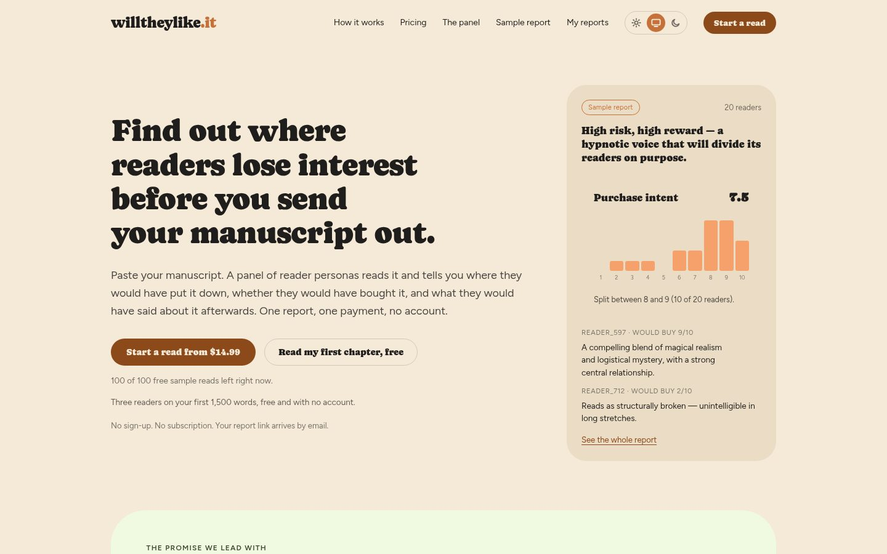
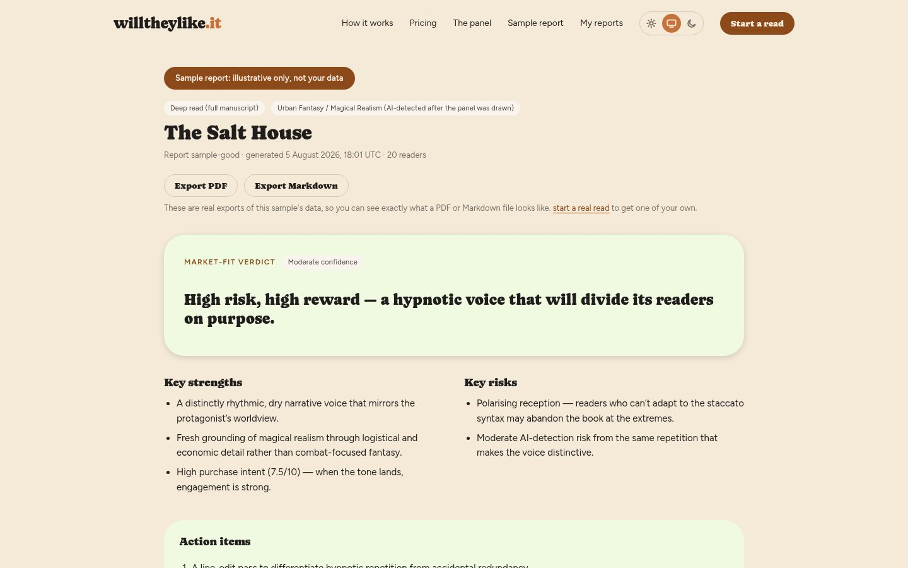
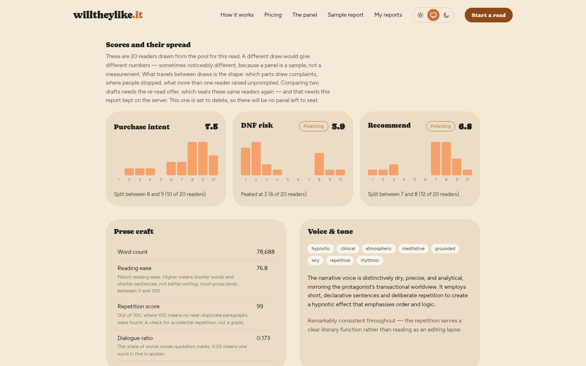
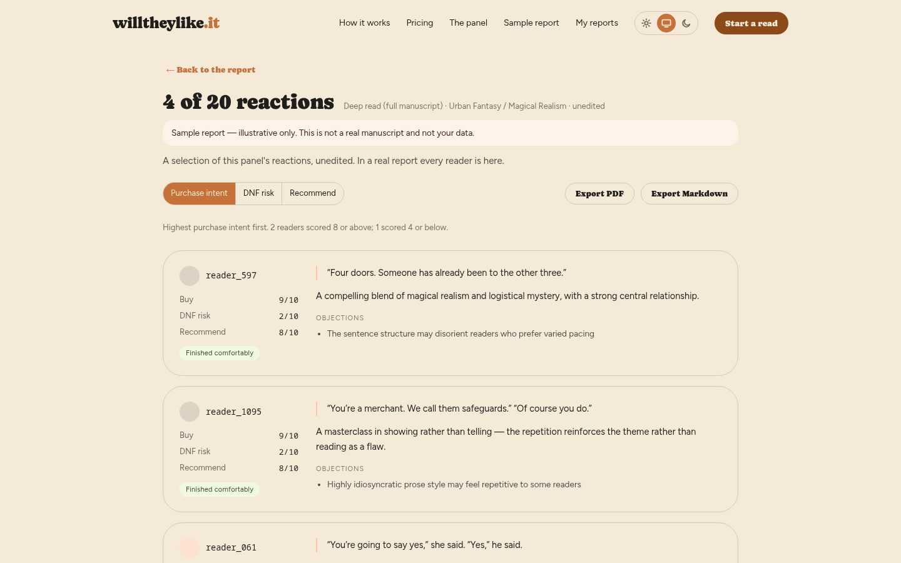
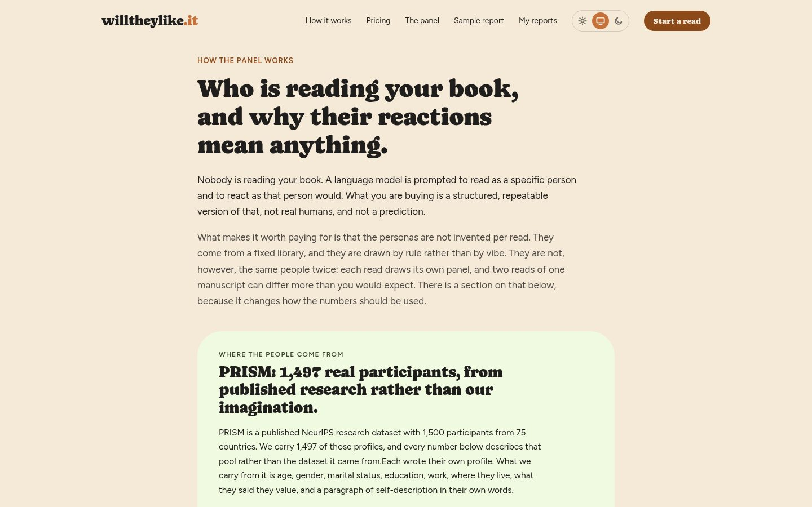

# willtheylike.it

**A paid, one-off manuscript-readiness report for authors about to self-publish or query agents.** An author pastes or uploads a manuscript and pays once, with no account and no subscription. A panel of simulated readers reads it and reports where each one would have stopped, whether they'd buy it and whether they'd recommend it. The report adds prose statistics, a voice and tone summary, an AI-writing heuristic and an overall market-fit verdict.

The report appears on screen and can be exported as PDF or Markdown. The site runs at [willtheylike.it](https://willtheylike.it) and is currently in a pre-launch phase, open to invited beta readers.



> Screenshots show a demo instance with sample data.

| Sample report | Scores and their spread |
|---|---|
|  |  |
| **Reader reactions** | **How the panel works** |
|  |  |

## Features

- **A reader panel drawn from real research data.** Personas come from 1,497 participant profiles in the PRISM Alignment Dataset (Kirk et al., 2024). The profiles are used as reading positions, not presented as real customers. The manuscript is embedded and ranked against the personas, and the panel is sampled across three fit tiers: 60 % best-fit, 25 % middle and 15 % least-fit. The least-fit readers are where most "did not finish" reactions come from, and leaving them out would flatter the author.
- **Same readers on the revised draft.** A discounted re-read stores the persona IDs and seats the same panel again, so a changed score reflects the draft rather than a different set of readers. A comparison view shows the differences between two reports and says whether they shared a panel.
- **Scores with their spread.** Purchase intent, DNF (did-not-finish) risk and likelihood to recommend, each with a 10-bucket histogram and a "polarising" flag, because an average can't tell a mediocre book from a divisive one.
- **Verified stopping points.** Each reader quotes the sentence where they stopped. The app looks for that sentence in the manuscript and shows a position only if it finds it. The report says how many quotes couldn't be located.
- **Grouped objections.** Reader objections are embedded, grouped by meaning and counted by distinct reader, so one talkative reader can't create a false consensus.
- **Prose craft and phrasing scan.** Word count, Flesch-Kincaid, repetition, dialogue ratio, and a scan for AI-typical phrasing reported as rates per 1,000 words. The AI heuristic is labelled as an LLM judgement, not a certified classifier.
- **Tiers and a free taster.** A Standard excerpt read with 12 readers, a Deep Read with 20 readers for a full manuscript, optional extra readers, and a free three-reader taster on the first 1,500 words with a site-wide daily budget.
- **Growth mechanics.** Half-price re-reads of revised drafts (capped per manuscript lineage), referral discounts that earn free reads, and prepaid pools with shareable claim links for writing groups and courses.
- **Accounts without passwords.** Buyers can sign in with a single-use magic link to see the reports they chose to keep, compare drafts, redeem credits or delete everything. Identity is just the email address on the purchase.
- **Automatic credits.** A paid job that fails on the service's side issues a free re-run immediately, with no support request needed.
- **Operator console.** Protected by TOTP and a magic link. It includes a KPI dashboard (revenue, orders, OpenRouter balance, taster-to-paid conversion, margin), masked account management with an append-only audit log, maintenance mode, model and provider switching from a hand-vetted list, refund bookkeeping, promo pools and endorsement moderation.
- **Consent-based endorsements.** Reader feedback becomes a public quote only after the operator promotes it and the author's specific consent is checked. The exact consent wording is stored, and withdrawal works through a link without logging in.
- **Public status page.** Queue depth, recent failure rate and median Deep Read duration are calculated on request, and incidents are posted by hand.
- **Self-protection.** When the OpenRouter balance drops below a threshold, the site switches to maintenance mode and emails the operator, so it doesn't sell a read it can't run.

## Tech stack

Python · FastAPI · PostgreSQL · SQLAlchemy / asyncpg · APScheduler · React 19 · Vite · React Router · TanStack Query · Stripe Checkout · Mailjet · OpenRouter · Ollama (local testing) · WeasyPrint · Docker · Apache · Cloudflare

## How it works

```
buyer ──► Stripe Checkout ──► webhook creates job ──► buyer submits manuscript
                                                           │  (held in memory only)
                                                           ▼
     reader panel selection ──► parallel reader calls (OpenRouter) ──► prose / voice / AI scans
                                                           │
                                                           ▼
                        synthesis ──► report (screen · PDF · Markdown) ──► email link
```

Payment comes before the manuscript, so no manuscript text goes through checkout. The text stays in process memory for the run and is then dropped. There is no database column for it and no uploads directory. The report keeps short verbatim quotes, such as flagged passages and stopping lines, so its findings can be checked.

Reports that aren't kept are scrubbed after 72 hours. Kept reports last 12 months, with a warning email before they expire. Scheduled jobs handle retention, nightly backups and sweeps that make sure no paying buyer is left with a stuck job. Marketing pages are prerendered at build time so they can be crawled. The backend has an extensive pytest suite.

## Design principles

- **The manuscript never reaches durable storage.** Pay first, submit after, drop the text when the run ends.
- **No tracking.** No analytics library, pixels or cookies. Operator metrics are server-side aggregates, and the only extra storage is daily counters with no column that could identify anyone.
- **No invented numbers.** No fabricated benchmarks, testimonials or status figures. Where there is no data, the UI shows nothing.
- **Honest about limits.** The site states plainly that the readers are not real people and the AI check is not a certified classifier, and it shows an unflattering sample report.
- **Computed, not asserted.** The parts an author acts on (score spreads, objection ranking, stopping points) are calculated in code rather than left to a model.

## Availability

The source code is not public. willtheylike.it is a commercial service of Munda Plus d.o.o. in pre-launch at [willtheylike.it](https://willtheylike.it). The platform is available for licensing, custom deployment or white-label adaptation. Get in touch via [munda.si](https://www.munda.si/#contact).

## License

Proprietary. © 2026 MUNDA PLUS d.o.o. All rights reserved. See [LICENSE](LICENSE).

## Author

Built by [Marko Munda](https://www.munda.si/) · [Munda Plus](https://github.com/MundaPlus)
